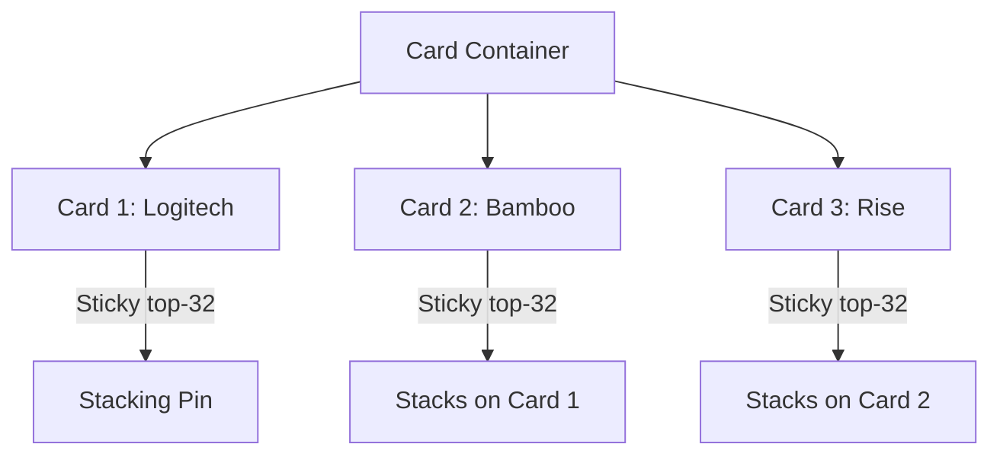

# Section Plan: Projects Page Redesign & Scroll Animations

This plan details the visual structure, layout classes, and next-level GSAP animations implemented to align `/projects` exactly with the interactive sticky piling experience seen on `dumemearts.webflow.io/projects`.

---

## 1. Stacking Card Deck Architecture

To match the reference site, the layout uses a **3D Stacking Card Deck**. In this design, project cards are stacked vertically. As the user scrolls down:
- The active card locks in place at the top.
- The next card scrolls up from below and stacks on top of it.
- The active card underneath shrinks in scale and dims in opacity to convey depth.



### Layout Variables & Spacing
- **Container**: Full-width scroll container wrapper.
- **Card Wrapper**: `min-h-[85vh]` sticky container (`sticky top-28 md:top-36`) with dynamic `z-index` (assigned sequentially based on project index) so cards overlay naturally.
- **Card Frame**: A large double-rounded capsule (`rounded-[2.5rem] md:rounded-[3.5rem] border p-8 md:p-16`) utilizing the project's brand background color.
- **Card Borders**: Styled to dynamically map `project.borderColor` (with `opacity-12` or `opacity-30` accents).

---

## 2. Card Content Layout (1:1 Webflow Replica)

Inside each project card, the content is split into left and right columns matching the exact proportions of the mockup:

```
+-----------------------------------------------------------------------------+
|  (01)                                                          [ VIEW -> ]  |
|                                                                             |
|  LOGITECH                                          +---------------------+  |
|  Designed a playbook containing...                 |                     |  |
|                                                    |     VIDEO / IMG     |  |
|  [Design Systems] [Digital Designer] [2023]        |     BILLBOARD       |  |
|                                                    +---------------------+  |
+-----------------------------------------------------------------------------+
```

### Left Column: Information Display
1. **Index Number**: `({project.id})` in parentheses rendered in monospaced layout (`font-mono`).
2. **Tall Project Title**: Tall, condensed text styled with custom typeface `font-humane` (Humane-Medium font) with high impact (`text-[7.5vw] leading-[0.8]`).
3. **Description**: Styled in custom body layout with color mapped to `project.textColor` (adapted to dark/light variants).
4. **Pills Tags**: Category and year parameters wrapped in border pills.

### Right Column: Double-Rounded Billboard Mockup
1. **Mockup Wrapper**: Container with aspect ratio `aspect-[16/10]` or `aspect-[1.9/1]`, finished with thick borders (`border-[8px]`) to mimic physical billboards.
2. **Media Layer**: Plays loops of compressed project videos (`mp4`) on hover and displays high-quality Webflow AVIF images as fallbacks.

### Top Right: magnetic CTA Button
- Capsule view indicator: `VIEW` with outline border, placed beside a bright yellow circle (`bg-[#ffd600]`) housing the arrow SVG.
- Magnetic effect triggered on cursor hover.

---

## 3. Stacking Card Animations (GSAP ScrollTrigger)

We control the stacking depth transition with a scroll-linked GSAP timeline:

```javascript
// Stacking card animation with GSAP ScrollTrigger
const cards = cardsRef.current.filter(Boolean);

cards.forEach((card, index) => {
  if (index === cards.length - 1) return; // Last card doesn't need to stack down

  gsap.to(card, {
    scale: 0.92,       // Shrinks card to convey physical depth
    opacity: 0.35,     // Dims card as next card overlays
    yPercent: -6,      // Translates card slightly up
    ease: "none",
    scrollTrigger: {
      trigger: cards[index + 1], // Triggered when the next card scrolls in
      start: "top 88%",          // Commences scale down
      end: "top 12%",            // Finalizes scale down when pinned
      scrub: true,
      invalidateOnRefresh: true,
    }
  });
});
```

---

## 4. Viewport Responsiveness

- **Desktop (width >= 991px)**: Displays the full interactive 3D Sticky Card Pile scroll animations.
- **Mobile (width < 991px)**: Switches dynamically to vertical scrolling cards without pinning, ensuring optimal touch scroll speed and keeping borders, colors, and typography consistent.
